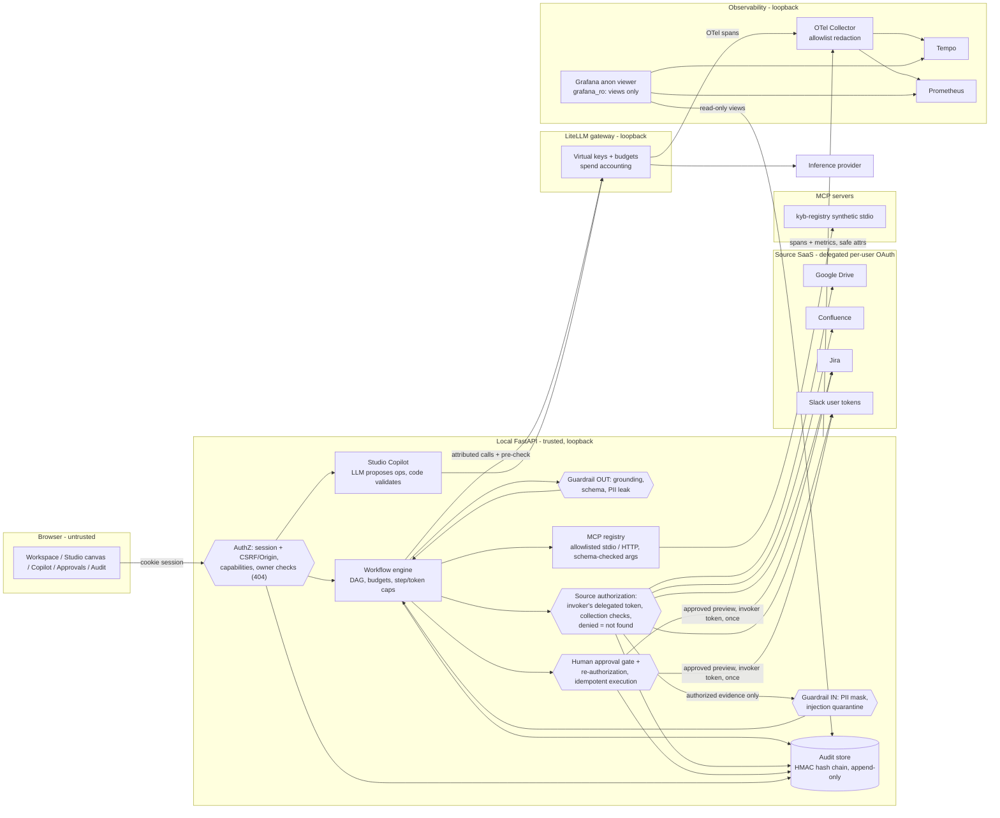

# Architecture (iteration 2)

Browser (React/TypeScript, React Flow Studio) → Vite `/api` proxy → local FastAPI (single process) → per-user authorization (`connections.access_context`) → source-native Drive / Confluence / Jira / Slack APIs with the **invoking user's delegated token** → fresh, bounded evidence → workflow engine or the fixed chat runner → guardrails → local LiteLLM gateway → configured inference provider. MCP tools (local synthetic `kyb-registry` over stdio, or registered HTTP servers) are called by the engine through the MCP registry. PostgreSQL holds application records and the hash-chained audit trail; a separate LiteLLM database holds gateway accounting and virtual keys. Traces and metrics flow app/LiteLLM → OTel Collector (allowlist redaction) → Tempo / Prometheus → Grafana, which also reads metadata views through a read-only role.

## Trust boundaries

Authorization sits at the API edge (sessions, capabilities, ownership) and, independently, at every source read (delegated token, collection membership, fresh permission). Guardrails sit between authorized evidence and any model call (input) and between model output and anything shown or acted on (output). The approval gate sits before every source write; execution re-authorizes the approver and the invoker's source access and runs exactly once per idempotency key.

## Permission model (unchanged invariants)

Source access = invoker's delegated identity ∩ app scopes ∩ workflow-allowed sources/tools ∩ platform policy. Platform roles (`user`, `builder`, `admin`, `auditor`) never widen source access. A published workflow built by an Admin and run by Operations reads and writes with Operations' tokens. There are no service accounts. Not-found and denied are indistinguishable; denials never reveal titles, counts or existence. Builders' drafts are runnable only by their owner until published to an audience; foreign workflow/run/approval ids return 404.

## Workflow engine

`WorkflowSpec` (versioned JSON in `workflow_versions`; published versions immutable) is the single source of truth for canvas, Copilot and engine. The engine validates (schema, reachability, no cycles, handles, ports, policy-allowed tools/sources/models, approval domination of write nodes), then executes a DAG with join semantics (a node runs when all predecessors are terminal and at least one incoming edge was taken; otherwise skipped). Node configs read prior outputs via `{{...}}` templates; routers and edge conditions use a whitelisted AST evaluator (no `eval`). Every node transition is a persisted event streamed over SSE; the canvas animates only from these events. Runs pause at `human.approval` with an exact preview of downstream write actions; paused runs survive restart. Node state persists only generated content, tool data and evidence references, never source excerpts.

Every model call goes through `ModelGateway` with user/workflow/version/node attribution, after an app-side budget pre-check (workflow budget and per-user monthly budget, warning at 80%) and per-run step/token caps; the workflow's LiteLLM virtual key enforces its budget again in the gateway. In-flight calls can overshoot a budget by at most one call.

## Guardrails

Deterministic first: PII masking with checksums (NRIC/FIN, UEN, IBAN mod-97, Luhn cards, phone, email) before model calls; prompt-injection heuristics quarantine instruction-like spans in retrieved content; grounding requires each factual sentence to cite valid evidence labels of the run and strips or repairs unsupported claims; JSON-schema validation of structured output; PII-leak check on output. Results are `guardrail_result` events and metrics.

## Audit

`audit_events` rows carry `seq`, `prev_hash`, `hash = HMAC_SHA256(AUDIT_HMAC_KEY, prev_hash || canonical_json(event))`, container (space/project/channel/folder), resource ids and per-resource decisions, workflow/version/node, and safe references (message/run ids), never excerpts. Inserts are sequenced under a transaction advisory lock by an ORM hook, so every module is chained. The API connects as `app_runtime`, which has no UPDATE/DELETE/TRUNCATE on the table; a trigger rejects them for everyone else. `GET /api/audit/verify` walks the chain and reports the first broken `seq`. Auditors query by filters or natural language (the LLM emits a validated AuditQuery JSON; code builds the query) and see questions/answers and per-resource decisions, never source excerpts. Auditor views are audited.

## Freshness

Retrieval is query-time and federated: no index, no source cache. Freshness is bounded by each provider's search indexing latency (measured values in the iteration 2 handoff). Revocation takes effect on the next run because every read uses the user's current delegated permission.

## Local runtime

`./scripts/start.sh --services compose` starts PostgreSQL, OTel Collector, Tempo, Prometheus and Grafana in Docker (loopback ports) and supervises LiteLLM, the API, the HTTPS OAuth callback shim (self-signed, for Slack's HTTPS redirect requirement) and Vite locally. Migrations are versioned (`backend/app/migrations.py`) and run as the database owner; the API runs as the runtime role. The native profile (no Docker) keeps the iteration 1 local OTLP receiver and has no Grafana.
